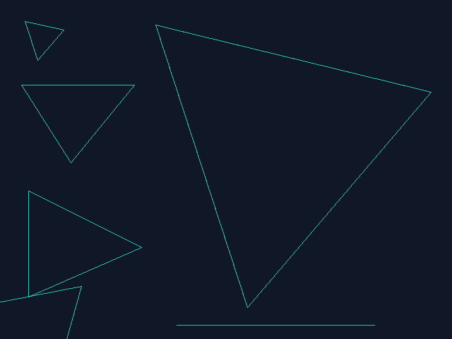
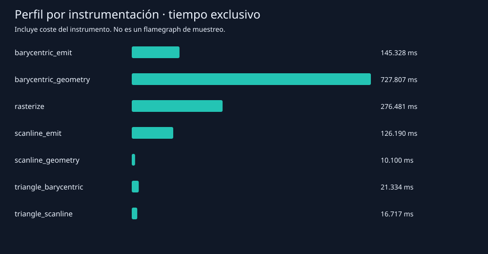

# Laboratorio: rasterización de triángulos

Proyecto Rust independiente, sin dependencias externas. Implementa contorno con Bresenham, relleno baricéntrico y relleno por líneas horizontales. Incluye imágenes reales del framebuffer, comparación de fragmentos, mediciones y un perfil por instrumentación.

## Ejecutar

Desde esta carpeta, con Rust y Cargo instalados:

```powershell
cargo run --release
cargo test --release
cargo run --release -- --benchmark-triangles
cargo run --release --features profile -- --profile-triangles
```

El primer comando compara los algoritmos y escribe las tres imágenes BMP de 640 × 480. Abre [resultados/index.html](resultados/index.html) en un navegador para verlas juntas. El programa no necesita ventana: procesa los fragmentos y los guarda directamente como imágenes. Los siguientes comandos ejecutan pruebas, mediciones sin instrumentación y el perfil, respectivamente.

## Implementación

En [src/lib.rs](src/lib.rs), `TriangleMode` selecciona `Wireframe`, `FilledBarycentric` o `FilledScanline`. `rasterize(&triangles, mode, width, height)` ensambla los resultados sin cambiar el procesamiento de fragmentos. Cada fragmento tiene posición entera y el mismo color RGB `(36, 196, 180)`.

- **Wireframe:** tres llamadas a `line`, implementada con Bresenham. Se conservan las repeticiones de los extremos compartidos entre líneas; no afectan a la imagen.
- **Baricéntricas:** recorre el rectángulo delimitador, recortado al framebuffer. Evalúa cada centro `(x + 0.5, y + 0.5)` y calcula los tres pesos como cocientes entre áreas orientadas. Emite el píxel cuando los tres pesos son no negativos. La división por el área con signo admite ambas orientaciones.
- **Scanline:** recorre las mismas filas, calcula intersecciones con las tres aristas y emite una sola vez cada píxel entre los extremos del tramo. No realiza pruebas baricéntricas por píxel.

### Convención de bordes y precisión

Ambos rellenos incluyen todos los centros que estén sobre el borde. Los vértices se representan con punto fijo de 8 bits fraccionarios: `Vertex::new(x, y)` acepta píxeles enteros y `Vertex::subpixels(x, y)` acepta unidades de 1/256 de píxel. Los productos geométricos usan `i128` para evitar desbordamiento dentro del rango de coordenadas `i32`.

En baricéntricas, los numeradores se calculan exactamente antes de convertirlos a `f64`; su signo y el cero se conservan. En scanline, las intersecciones permanecen como fracciones exactas y se usan divisiones enteras con piso/techo para localizar centros de píxel. No se necesita un épsilon distinto entre algoritmos.

Una arista horizontal contribuye ambos extremos únicamente cuando coincide con el centro de la fila. Un vértice puede aparecer como intersección de dos aristas, pero solo se conserva el mínimo y máximo, por lo que no duplica fragmentos. Esta convención es inclusiva, no la regla *top-left*: dos triángulos adyacentes pueden emitir el mismo centro de su arista compartida. No hay duplicados dentro de un triángulo relleno.

Los triángulos de área cero no producen fragmentos en los modos rellenos. Wireframe sigue mostrando sus líneas. Las posiciones fuera del framebuffer se descartan; un framebuffer vacío produce rellenos vacíos.

## Imágenes

Las tres imágenes utilizan los mismos triángulos y color. El triángulo grande en orden inverso se superpone al original; el degenerado solo se ve en contorno.

| Contorno | Baricéntricas | Scanline |
| --- | --- | --- |
|  |  |  |

## Comparación exacta

Resultados obtenidos ejecutando `cargo run --release`; archivo completo: [comparacion.csv](resultados/comparacion.csv).

| Caso | Fragmentos baricéntricos | Fragmentos scanline | Posiciones diferentes |
| --- | ---: | ---: | ---: |
| Pequeño | 1.405 | 1.405 | 0 |
| Grande | 71.825 | 71.825 | 0 |
| Borde horizontal | 8.810 | 8.810 | 0 |
| Borde vertical | 12.000 | 12.000 | 0 |
| Orden inverso | 71.825 | 71.825 | 0 |
| Parcialmente fuera | 6.554 | 6.554 | 0 |
| Colineal | 0 | 0 | 0 |

Se compararon conjuntos de posiciones y se verificó que ninguno de los rellenos generara duplicados por triángulo. Los seis tests también comprueban colores, las seis permutaciones de vértices, una figura con píxeles esperados especificados manualmente, horizontales y vértices sobre centros de píxel, framebuffer vacío, vértices repetidos y 2.000 triángulos subpíxel pseudoaleatorios con semilla fija. **6 tests aprobados.** `cargo clippy --all-targets --all-features -- -D warnings` también pasó.

## Mediciones reales

Entorno: Intel Core i5-10400 a 2,90 GHz, Windows NT 10.0.19045, Rust 1.98.1, destino `x86_64-pc-windows-msvc`. Resultados obtenidos el 21 de octubre de 2026.

Medición en compilación `release`, sin la característica `profile`. Se hicieron 10 ejecuciones de calentamiento por modo y 9 rondas de 100 ejecuciones por modo, alternando el orden de los modos. Se reporta la mediana de las nueve medias por ejecución, no una mediana de tiempos individuales. Se usa `Instant` y `black_box`.

| Modo | Fragmentos por ejecución | Mediana (ms/ejecución) | Mínimo de ronda | Máximo de ronda |
| --- | ---: | ---: | ---: | ---: |
| Wireframe | 3.962 | 0,029115 | 0,028268 | 0,110851 |
| Baricéntricas | 172.419 | 8,780444 | 8,400948 | 9,304102 |
| Scanline | 172.419 | 2,219865 | 1,962220 | 2,708994 |

Scanline fue aproximadamente **3,96 veces más rápido** en este conjunto, generando exactamente la misma cantidad de fragmentos. Wireframe realiza otro trabajo y su tiempo no representa una alternativa equivalente al relleno.

La región medida incluye los cálculos, creación, crecimiento, concatenación y liberación de los `Vec`. Excluye comparación de conjuntos, imágenes, impresión, escritura de archivos y esperas. El conjunto contiene el triángulo grande dos veces, una por orientación: el recuento es de fragmentos generados, no de píxeles únicos de la escena.

Los resultados dependen del equipo y su carga. Los cálculos exactos con `i128` y el vector temporal por fila del modo baricéntrico también influyen; estos números comparan estas implementaciones, no establecen una ventaja universal.

- [Todas las rondas](resultados/mediciones.csv)
- [Resumen de medianas](resultados/resumen.csv)

## Perfil de ejecución

No estaba instalado `cargo-flamegraph` en el entorno. Se implementó un **perfilador por instrumentación** en [src/profiler.rs](src/profiler.rs), activado con la característica `profile`. Registra llamadas, tiempo inclusivo y tiempo exclusivo de ámbitos anidados mediante `Instant`. Se ejecutaron 100 repeticiones por algoritmo relleno, sin imágenes ni comparación de conjuntos. El perfil real se entrega como [perfil.csv](resultados/perfil.csv) y [perfil.svg](resultados/perfil.svg).



| Ámbito | Tiempo exclusivo acumulado (ms) |
| --- | ---: |
| Geometría baricéntrica | 727,807 |
| Emisión baricéntrica | 145,328 |
| Geometría scanline | 10,100 |
| Emisión scanline | 126,190 |
| Ensamblaje en rasterize | 276,481 |

La geometría baricéntrica ocupa aproximadamente el 55 % del tiempo inclusivo total de `rasterize` del perfil. Recorre todo el rectángulo delimitador, calcula tres áreas y tres cocientes por candidato, y almacena posiciones aceptadas en un vector temporal reutilizado. Scanline calcula intersecciones por fila; en ese modo domina la emisión de fragmentos.

Los ámbitos de emisión incluyen `Vec::push` y sus posibles realocaciones. El tiempo exclusivo de `rasterize` incluye concatenación y liberación de vectores temporales. El perfil no separa el asignador ni las instrucciones aritméticas individuales; no permite atribuirles porcentajes propios. Una mejora a investigar sería reservar capacidad o emitir directamente al vector final.

Este SVG representa tiempos exclusivos acumulados, **no es un flamegraph de muestras de CPU**. La instrumentación añade sobrecoste y parte de este queda en los ámbitos padres; por eso se usa una ejecución separada para las medianas. En una máquina con `cargo-flamegraph` y su backend disponibles, también se puede obtener un perfil estadístico ejecutando:

```text
cargo flamegraph -- --benchmark-triangles
```

Ese comando se proporciona como alternativa y no fue ejecutado aquí. En un flamegraph, la anchura indica proporción de muestras, no el orden temporal de las funciones.

## Archivos

- `src/lib.rs`: tipos, rasterizador y casos del laboratorio.
- `src/main.rs`: comparación, generación BMP, benchmark y modo de perfilado.
- `src/profiler.rs`: perfilador opcional por ámbitos.
- `tests/rasterization.rs`: pruebas de corrección y bordes.
- `resultados/`: imágenes, visor HTML, mediciones y perfil obtenidos.

No se necesita instalar bibliotecas de gráficos ni descargar crates. `Cargo.lock` está incluido para reproducir el proyecto.
